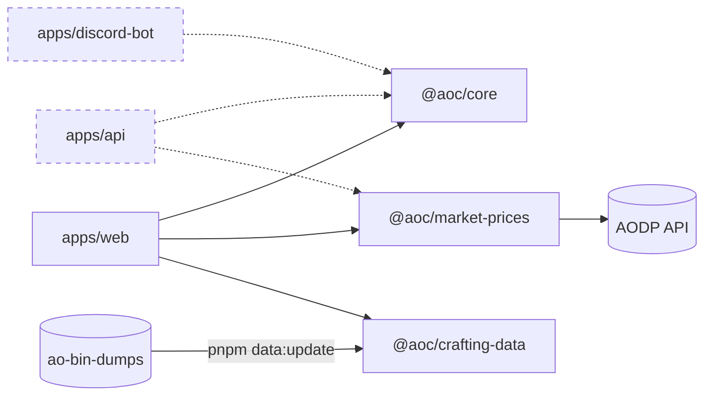

# Albion Crafting

Find the most profitable items to craft in Albion Online for a route you choose: where you craft, where you buy materials and where you sell, including the Black Market. Market prices come from the [Albion Online Data Project](https://www.albion-online-data.com/), with manual entry where the data is missing. Recipes and crafting bonuses come from [ao-bin-dumps](https://github.com/ao-data/ao-bin-dumps), and a weekly job opens a PR when they change.

**Live at https://ralphaile.github.io/albion-crafting/.** Every change to `main` is deployed there automatically.

> **Status:** early development. The project skeleton is in place, and features are added ticket by ticket.

## Getting started

Requires Node.js 24.22.1, the version pinned in `.nvmrc`. pnpm comes from Corepack, which ships with Node.

```sh
nvm install 24.22.1
nvm use 24.22.1
corepack enable pnpm
pnpm install
pnpm --filter @aoc/web exec playwright install chromium   # browser for pnpm e2e
pnpm dev   # http://localhost:5173/albion-crafting/
```

`pnpm install` also sets up git hooks that check each commit. See [docs/git.md](docs/git.md).

## Scripts

| Command               | What it does                                                                                                                                                                         |
| --------------------- | ------------------------------------------------------------------------------------------------------------------------------------------------------------------------------------ |
| `pnpm dev`            | Starts the web app with live reload                                                                                                                                                  |
| `pnpm build`          | Builds all packages and the web app                                                                                                                                                  |
| `pnpm typecheck`      | Checks types in all packages                                                                                                                                                         |
| `pnpm lint`           | Lints all packages                                                                                                                                                                   |
| `pnpm test`           | Runs the unit and component tests once                                                                                                                                               |
| `pnpm test:watch`     | Reruns the tests when files change                                                                                                                                                   |
| `pnpm coverage`       | Runs the tests and fails if a package drops below its coverage minimum                                                                                                               |
| `pnpm e2e`            | Builds the web app and runs the end-to-end tests in Chromium                                                                                                                         |
| `pnpm format`         | Formats the code                                                                                                                                                                     |
| `pnpm format:check`   | Checks formatting without changing files                                                                                                                                             |
| `pnpm check:deps`     | Checks which packages may import which                                                                                                                                               |
| `pnpm check:unused`   | Finds unused files, exports and dependencies                                                                                                                                         |
| `pnpm check:versions` | Checks that shared dependencies use the same version everywhere                                                                                                                      |
| `pnpm data:diff`      | Compares the generated game data with the committed data and writes a report of the changes to `packages/crafting-data/data-diff.md`                                                 |
| `pnpm data:update`    | Downloads and checks the game files at the pinned commit, then generates the crafting locations, hideout bonuses, recipes and item names. `--latest` moves the pin to the newest one |

## Project layout

A pnpm + Turborepo monorepo. The web app uses Vite and React. Dashed parts come in a later release. [ADR-001](docs/adr/001-monorepo-with-a-pure-core.md) explains the split.



| Folder                       | What it is                                                                                                                                                                                                                                                     |
| ---------------------------- | -------------------------------------------------------------------------------------------------------------------------------------------------------------------------------------------------------------------------------------------------------------- |
| `apps/web`                   | The website: pick a route and settings, and get a ranked list of the best crafts                                                                                                                                                                               |
| `packages/core`              | The calculation engine: production bonus in cities, Rests, islands and hideouts, return rate, material cost, station fee, revenue after taxes, focus cost, profit and ranking. It has no network or storage code, so a future API and Discord bot can reuse it |
| `packages/market-prices`     | The markets the app trades in, and a client for their live prices from the Albion Online Data Project (AODP) API that keeps to its request limits, marking each price fresh, stale or missing                                                                  |
| `packages/crafting-data`     | Recipes, item values, names, icons, locations and crafting bonuses, extracted from the game files                                                                                                                                                              |
| `packages/config-typescript` | Shared strict TypeScript settings                                                                                                                                                                                                                              |
| `packages/config-eslint`     | Shared lint rules                                                                                                                                                                                                                                              |
| `.github`                    | The CI and CodeQL workflows, Renovate's settings, PR and issue templates, and the rules that protect `main`                                                                                                                                                    |
| `docs`                       | Guides: [tests](docs/testing.md), [git, CI and deployment](docs/git.md), [game data](docs/game-data.md), [market prices](docs/market-prices.md), the [glossary](docs/glossary.md) and the [architecture decisions](docs/adr/README.md)                         |

Albion Crafting is a fan project and is not affiliated with or endorsed by Sandbox Interactive GmbH. Albion Online is their trademark.
